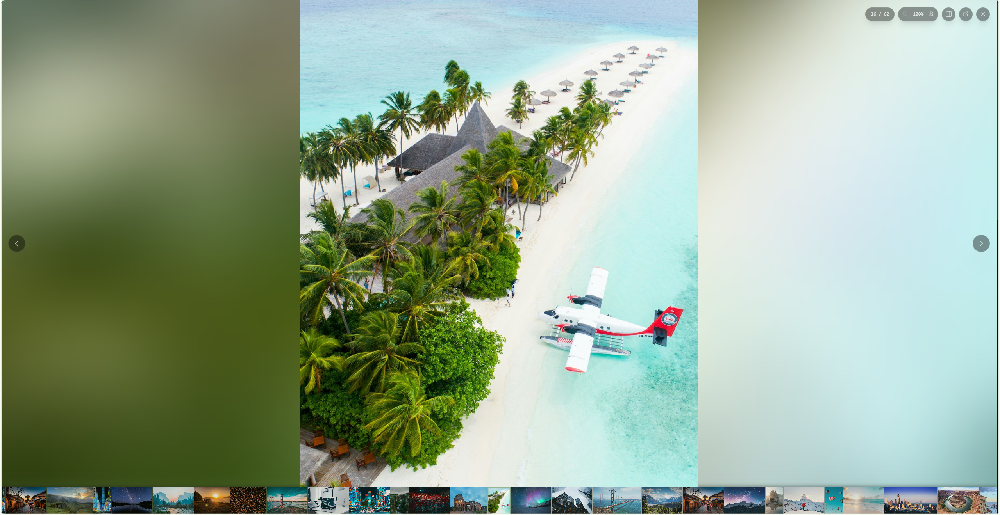
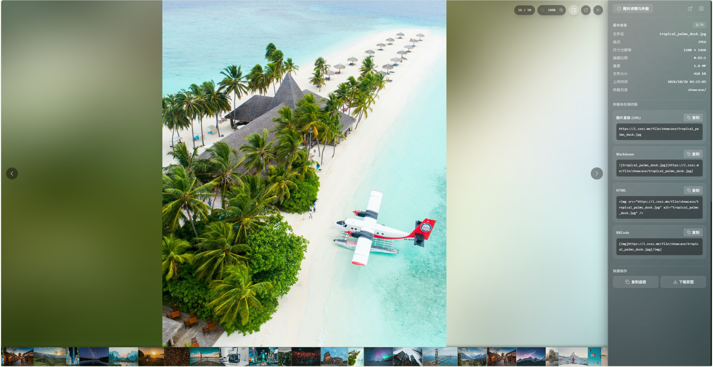
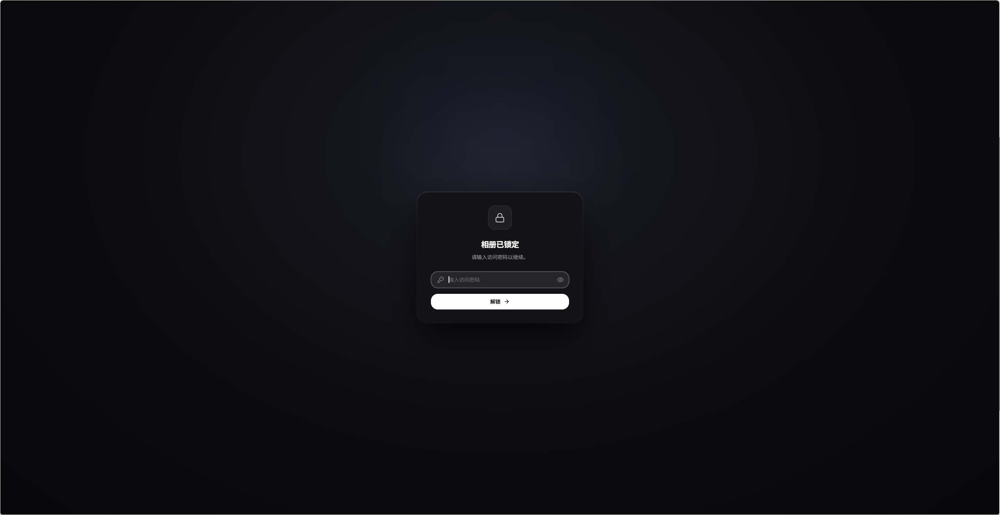

# cfbed-gallery 📸

> [Cloudflare-ImgBed](https://github.com/marisn2017/Cloudflare-ImgBed) 的纯 Serverless 现代画廊前端，通过官方 REST API 纯实时访问，**专注于高质感看图体验**。

[](https://vercel.com/new/clone?repository-url=https%3A%2F%2Fgithub.com%2Fllxo%2Fcfbed-gallery&env=API_BASE,API_TOKEN,ADMIN_PASSWORD&envDescription=API_BASE%EF%BC%9ACloudflare-ImgBed%20%E5%9C%B0%E5%9D%80%EF%BC%8CAPI_TOKEN%EF%BC%9A%E5%9B%BE%E5%BA%8A%E7%AE%A1%E7%90%86%E5%91%98%20Token%EF%BC%8CADMIN_PASSWORD%EF%BC%9A%E7%9B%B8%E5%86%8C%E8%AE%BF%E9%97%AE%E5%AF%86%E7%A0%81&project-name=cfbed-gallery&repository-name=cfbed-gallery)
[](https://app.netlify.com/start/deploy?repository=https://github.com/llxo/cfbed-gallery)
[](LICENSE)

---

## 💡 项目定位与特性

原版 **Cloudflare-ImgBed** 侧重于后端的存储对接与基础管理，默认界面较为简易。

`cfbed-gallery` 是专门为 **“注重看图”** 打造的纯 Serverless 独立前端：
- **注重看图**：以自适应瀑布流画卷、全屏流光大图灯箱、单页元数据抽屉为核心，带来流畅自然的浏览体验；
- **纯 API 实时读取**：无需静态构建生成清单，网页打开即通过 REST API 纯实时拉取上游 cfbed 图床数据，上传照片一刷新立刻秒出；
- **边缘代管密钥**：通过轻量 Edge BFF 代理访问，Token 与访问密码完全保存在 Serverless 服务端，前端无任何密钥泄露风险；
- **完整外链自动生成**：复制图片直链、Markdown、HTML 或 BBCode 时，系统自动补全完整绝对网址，贴到博客、笔记或聊天工具中直接可用；
- **零服务端运维**：纯 Serverless 架构，免费额度充裕，无需运维任何 VPS 服务器。

---

## 📸 界面预览

| 瀑布流画卷 (Masonry Grid) | 全屏流光灯箱 (Lightbox) |
| :---: | :---: |
|  |  |

| 元数据抽屉 (Detail Drawer) | 访问锁屏门禁 (Lock Screen) |
| :---: | :---: |
|  |  |

---

## ☁️ 一键快速部署（Serverless）

本项目为纯 Serverless / Edge 架构，无需自备服务器，零维护成本。推荐直接使用以下平台部署。

### 方式一：Vercel 一键部署（最快）

点击下方按钮一键克隆并部署到 Vercel，平台会自动提示填写环境变量：

[](https://vercel.com/new/clone?repository-url=https%3A%2F%2Fgithub.com%2Fllxo%2Fcfbed-gallery&env=API_BASE,API_TOKEN,ADMIN_PASSWORD&envDescription=API_BASE%EF%BC%9ACloudflare-ImgBed%20%E5%9C%B0%E5%9D%80%EF%BC%8CAPI_TOKEN%EF%BC%9A%E5%9B%BE%E5%BA%8A%E7%AE%A1%E7%90%86%E5%91%98%20Token%EF%BC%8CADMIN_PASSWORD%EF%BC%9A%E7%9B%B8%E5%86%8C%E8%AE%BF%E9%97%AE%E5%AF%86%E7%A0%81&project-name=cfbed-gallery&repository-name=cfbed-gallery)

部署后即可直接访问，项目内置的 `vercel.json` 会自动处理 Edge 代理与路由重写。

---

### 方式二：Cloudflare Pages 部署（推荐生态）

若图床本身托管在 Cloudflare，优先推荐部署至 Cloudflare Pages，享受同生态低延迟：

1. 打开 [Cloudflare Dashboard](https://dash.cloudflare.com/)，进入 **Workers 和 Pages** -> **创建应用程序** -> **Pages** -> **连接到 Git**；
2. 选择本仓库 `llxo/cfbed-gallery`；
3. 构建配置：
   - **框架预设 (Framework preset)**: `Vite`
   - **构建命令 (Build command)**: `pnpm build`
   - **构建输出目录 (Build output directory)**: `dist`
4. 展开 **环境变量 (Environment variables)**，添加私有变量（详见下方变量表）：
   - `API_BASE`
   - `API_TOKEN`
   - `ADMIN_PASSWORD`
   - （可选）`SESSION_SECRET`
5. 点击 **保存并部署**。内置的 `functions/` 目录会自动编译为 Cloudflare Pages Functions 边缘服务。

---

### 方式三：Netlify 一键部署

点击下方按钮一键部署到 Netlify：

[](https://app.netlify.com/start/deploy?repository=https://github.com/llxo/cfbed-gallery)

在 **Site configuration** -> **Environment variables** 中配置环境变量即可，项目内置 `netlify.toml` 会自动启用 Edge Functions。

---

### 环境变量说明

部署到上述任何平台均需配置以下环境变量：

| 变量名 | 必填 | 说明 | 示例 |
| :--- | :---: | :--- | :--- |
| `API_BASE` | 是 | Cloudflare-ImgBed 后端上游地址（末尾不加斜杠） | `https://imgbed.example.com` |
| `API_TOKEN` | 是 | Cloudflare-ImgBed 管理员 API Token（需要读取权限） | `imgbed_your_token_here` |
| `ADMIN_PASSWORD` | 是 | 相册访问密码（访问受保护相册时解锁使用） | `your_secure_password` |
| `SESSION_SECRET` | 否 | 会话签名密钥（用于 HMAC Cookie 签名；留空则基于密码自动安全派生） | `random_secret_string` |

---

## 💻 本地开发

若需要进行功能扩展、样式定制或本地调试：

### 1. 克隆代码

```bash
git clone https://github.com/llxo/cfbed-gallery.git
cd cfbed-gallery
pnpm install
```

### 2. 配置本地环境变量

复制 `.env.example` 为 `.env`：

```bash
cp .env.example .env
```

在 `.env` 中填入你的上游图床信息：

```ini
API_BASE=https://imgbed.example.com
API_TOKEN=imgbed_your_admin_token_here
ADMIN_PASSWORD=your_secure_password_here
```

### 3. 启动开发服务器

```bash
pnpm dev
```

本地 Vite 开发服务器内置了与生产环境一致的 Edge BFF 中间件模拟，能够完整模拟代理、鉴权与会话逻辑。

### 4. 生产构建与预览

```bash
pnpm build
pnpm preview
```

---

## 🛠️ 技术栈

- **前端核心**：[React 19](https://react.dev/) + [TypeScript 5](https://www.typescriptlang.org/)
- **边缘架构 (BFF)**：Web 标准 Request/Response + Web Crypto API（兼容 Cloudflare Pages Functions / Vercel Edge / Netlify Edge）
- **构建工具**：[Vite 6](https://vitejs.dev/)
- **样式方案**：[Tailwind CSS v4](https://tailwindcss.com/)
- **图标体系**：[Lucide React](https://lucide.dev/)

---

## 💖 致谢与灵感来源

- **前端视觉与交互设计**：暗黑玻璃美学、双缓冲流光灯箱（Lightbox）与元数据侧栏抽屉复刻致敬自优秀开源摄影相册项目 [Afilmory](https://github.com/afilmory/afilmory)。
- **后端图床服务**：基于开源的 [Cloudflare-ImgBed](https://github.com/marisn2017/Cloudflare-ImgBed) 图床系统。

---

## 📄 License

[MIT](LICENSE)
